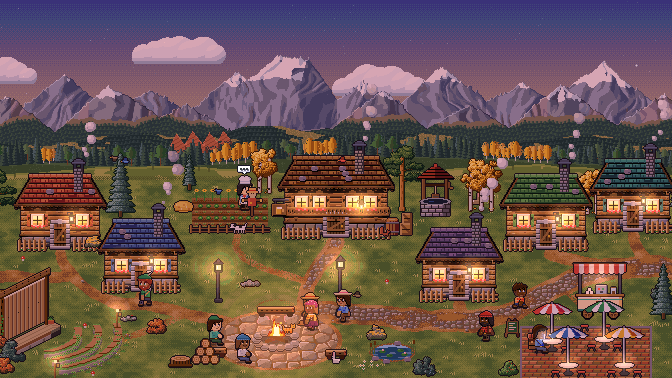
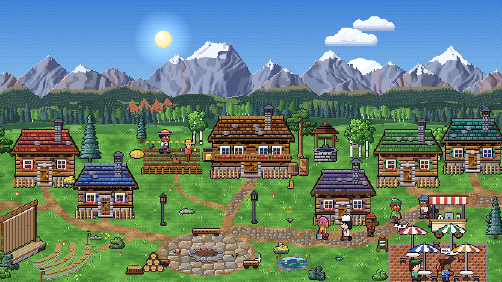
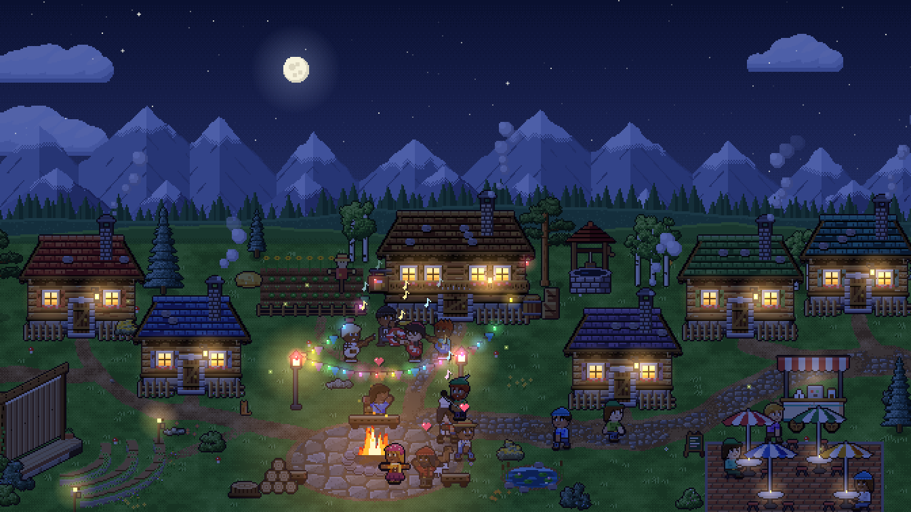

# HA Companion Village

A tiny living pixel-art village for your Home Assistant dashboard. Villagers wake up, cook breakfast,
farm, chop wood, haul water, gather round the campfire, throw parties and go to bed, all following
your home's clock, the weather, and whatever is happening in your house.






- **Retro pixel-art look.** Chunky outlined sprites, hue-shifted shading and dithered skies, all drawn
  procedurally at 672×378 in a retro art style.
- **Reacts to your home.** Scenes, scripts, automations, buttons, switches, media players, people,
  alarms, sensors: tie any of them to a village mood.
- **Visual editor.** Set everything up from the card's configuration screen, with suggestions based on
  what's in your Home Assistant. No YAML needed (but YAML works too).
- **Single file, zero dependencies.** It's a dashboard card that runs in the browser, so your Home
  Assistant box only serves one ~300 KB file. No add-on, no container, no polling, no network requests.
- **Light enough for wall tablets.** Scenery, glows and sprites are drawn once and cached, so a frame
  takes about a millisecond on a desktop. Startup work is spread over several frames. It stops completely when
  the card is off screen or the tab is hidden, drops to 10 fps by itself on a device that can't keep
  up, and several village cards on one page share their scenery.

## Install

Requires Home Assistant 2024.11 or newer.

### HACS (recommended)
1. In HACS → ⋮ → **Custom repositories**, add `https://github.com/frankdeluxe5k/companion-village-card`
   as type **Dashboard**. Or use this link:
   [](https://my.home-assistant.io/redirect/hacs_repository/?owner=frankdeluxe5k&repository=companion-village-card&category=plugin)
2. Download **HA Companion Village**. HACS adds the dashboard resource for you
   (`/hacsfiles/companion-village-card/companion-village-card.js`) and tells you when there's an update.
3. Edit a dashboard → **Add card** → search for **HA Companion Village**.

### Manual
1. Download `companion-village-card.js` from the latest
   [release](https://github.com/frankdeluxe5k/companion-village-card/releases) and copy it to
   `/config/www/companion-village-card.js`.
2. **Settings → Dashboards → ⋮ → Resources → Add resource**
   URL `/local/companion-village-card.js?v=1`, type **JavaScript module**.
   (Bump `?v=` whenever you update the file so browsers pick up the new version.)
3. Edit a dashboard → **Add card** → search for **HA Companion Village**.

Already using the original `pixel-village-card`? This card has its own name (`custom:companion-village-card`)
and file, so both can be installed side by side while you move over.

Nothing else to set up: the card finds your weather entity and the sun on its own, and follows your
time zone (your profile's "local" or "server" time zone setting is respected).

## Setting it up

Add the card and open its editor. Everything is on one screen:

- **Village:** title, number of residents (1–10), visitors and animals on/off, status line, frame rate.
- **Surroundings:** weather and sun entities, and an optional *mood helper* (see below).
- **Daily routine:** when the village wakes, works, eats, gathers by the fire and goes to bed.
- **Reactions:** tie things in your home to village moods. Each reaction is *"when this → condition →
  the village goes into…"*. Reorder them with the arrows: the first one that matches wins.
- **Suggestions:** the editor looks through your entities and proposes reactions, e.g. a scene called
  "Movie Night", a TV that's playing, an alarm armed away, nobody being home, a "Goodnight" script.
  Add them one by one or all at once, then tweak.

### Reaction conditions

| condition (`when:`) | matches | good for |
|---|---|---|
| `activated` | the entity was activated in the last `duration` minutes (default 120). Scenes, buttons and events use their activation time, scripts and automations their last run; other entities count any state change. If several are recent, the most recent one wins. | scenes, scripts, automations, buttons |
| `on` | the state is "on-ish": `on`, `home`, `open`, `playing`, `active`, `detected`, `armed_*`, `heat`, … | switches, input booleans, lights, motion |
| `state` | the state (or `attribute`) is one of `state:` | media players, people, alarms, selects |
| `not_state` | the state (or `attribute`) is none of `state:` | "Frank is not home" |
| `numeric` | the state (or `attribute`) is `above:` and/or `below:` a number | sensors, `zone.home` (people at home), brightness |

Unavailable or unknown entities never match, and never-used scenes or buttons don't count as
activated. A newer activation always cancels older ones, even once its own duration has run out.

Besides the moods below, a reaction can send the village back to its **daily routine** (`mode: auto`),
or bring a **village event** on demand (`mode: event:landscapers`, see [Events](#events)).
That's handy for a "Good morning" scene that should end "Good night" and let the normal day play out.

### YAML

The editor writes plain YAML, so you can also write it yourself:

```yaml
type: custom:companion-village-card
title: Thornbrook
villagers: 6
weather_entity: weather.home
schedule:
  wake: "06:30"
  sleep: "22:30"
triggers:                       # first match wins
  - entity: alarm_control_panel.home
    when: state
    state: [armed_away, armed_vacation]
    mode: away
    label: Out adventuring
  - entity: zone.home           # number of people at home
    when: numeric
    below: 1
    mode: away
  - entity: scene.party_time
    when: activated
    duration: 180
    mode: party
  - entity: script.movie_night
    when: activated
    duration: 150
    mode: movie
  - entity: media_player.living_room_tv
    when: state
    state: playing
    mode: movie
  - entity: scene.good_morning   # back to the normal day
    when: activated
    duration: 900
    mode: auto
  - entity: input_boolean.guests
    when: "on"
    mode: party
  - entity: sensor.living_room_lux
    when: numeric
    below: 20
    mode: cozy
```

Older configs without `when:` keep working: scenes, scripts and buttons default to `activated`,
entries with `state:` to `state`, and everything else to `on`.

### Moods

| mode      | what happens |
|-----------|--------------|
| `sleep`   | Everyone's in bed, windows dark, little z's float from the houses |
| `morning` | Villagers come out stretching, the cook makes breakfast, smoke from chimneys |
| `work`    | Farmer tends the field, woodcutter chops and hauls logs, water carrier runs to the well, bard busks, kid plays |
| `meal`    | Pot over the fire, everyone sits round eating (breakfast / lunch / dinner text depends on the hour) |
| `evening` | Campfire, chatting, the bard plays, the kid goes to bed early |
| `party`   | Big fire, string lights, dancing in a ring, and a travelling band |
| `movie`   | Movie night at the amphitheater: the screen rolls down, the cook makes popcorn, a projector comes out and everyone takes a seat |
| `gaming`  | Game night: retro games on the big screen with players on wired controllers, and handheld consoles at the café |
| `cozy`    | Everyone indoors with warm lit windows and smoking chimneys |
| `away`    | Everyone grabs a backpack and walking stick and heads off on an adventure. The last one out pulls down the amphitheater screen with a "BACK SOON!" sign on it, and it goes back up when the village leaves away mode |

### Events

About once a day (you can choose rarely, daily or often), a visiting crew drops by during the day.
Villagers and visitors wander over to watch, and each crew leaves the village as tidy as it found it.

| event | `mode:` for a reaction | what happens |
|---|---|---|
| 🛒 Travelling merchant | `event:merchant` | Leads his mule and cart in along the west lane, unrolls the canopy and sets out fruit, jars and cloth while the mule grazes; people browse and buy |
| 💼 Door-to-door salesman | `event:salesman` | Bowler hat and sample case; knocks on doors (someone home might buy, an empty house gets a shrug) and pitches to people in the street |
| 🎨 Visiting artists | `event:artists` | Three artists chisel and paint a sculpture by the farm, then unveil it; it stays on show until bedtime |
| ✂️ Landscapers | `event:landscapers` | Trim every shrub into a tidy dome, prune trees from a ladder and wheel the clippings away; the trims last the day |
| 🎠 Travelling fair | `event:fair` | A striped tent, a hand-cranked carousel kids love and a ring toss; more visitors come, and it runs into the evening with lights |

Events skip rain, snow and storms, and nights, movie nights, game nights, cozy evenings and adventures.
Every dashboard shows the same event on the same day. Tie one to anything in your home with a reaction,
for example a "Gardener visit" button, a "Market day" scene or your doorbell; the suggestions offer these
when your entity names fit.

```yaml
events: true                 # default
event_frequency: daily       # rare (a couple a week), daily or often (a few a day)
triggers:
  - entity: input_button.gardener_visit
    when: activated
    duration: 60
    mode: event:landscapers
```

### Driving it from automations

Create an `input_select` (or `select`) with the options `auto, sleep, morning, work, meal, evening, party,
movie, gaming, cozy, away`, pick it as the **mood helper**, and set it from any automation with
`input_select.select_option`. `auto` (or anything that isn't a mood name) falls back to reactions and the
daily routine. Reactions take priority over the mood helper.

## The village

Six houses along a cobbled main road and dirt paths, a fire square with benches and lamps, a café with
umbrella tables and a coffee cart, a rustic amphitheater, a pond, a farm at the back and a well behind
the tavern.

- **Residents:** a farmer, cook, woodcutter, water carrier, bard and a kid (more if you raise the count).
- **Visitors** wander in by the east road or the west lane, sightsee, grab a coffee, sit by the fire and
  leave again. More turn up for evenings, movie nights and parties; nobody visits at night.
- **The mail carrier** cycles in every few minutes during the day, parks at two or three houses and
  walks a letter (or sometimes a parcel) to the door.
- **Visiting crews** for the [events](#events): a merchant, a salesman, artists, landscapers and fair folk.
- **A travelling band** of young rockers (drums, bass and two guitars) arrives for parties and plays in
  front of the tavern.
- **Animals:** two dogs follow their owners and nap by the door at night, a cat lounges about and bolts
  from the dogs, birds flock and peck, and rabbits and squirrels scatter when anyone comes close.

## All options

| option | default | notes |
|---|---|---|
| `title` | none | Card header |
| `villagers` | `6` | Residents, 1–10 |
| `visitors` | `true` | Visitors, the mail carrier and the party band |
| `animals` | `true` | Dogs, cat, birds, rabbits and squirrels |
| `weather_entity` | first `weather.*` | Set `false` to turn weather off. Every Home Assistant condition is drawn: sun, clear night, clouds, wind, fog, rain, pouring rain, lightning, thunderstorms, hail, snow and sleet. Heavy rain, hail and storms send workers indoors |
| `sun_entity` | `sun.sun` | Drives dawn, day, dusk, night and the sun's position. Without it the clock decides. South of the equator (from your Home Assistant location) the sun's path and the seasons follow your hemisphere |
| `mode_entity` | none | Mood helper (`input_select`, `select` or `input_text`) |
| `schedule` | 06:30 wake, 08:30 work, 12:00 lunch, 13:00 work, 18:00 dinner, 19:30 evening, 22:30 sleep | `"HH:MM"` strings. A `sleep` earlier than `wake` (e.g. `"00:30"`) means after midnight |
| `triggers` | `[]` | Reactions, see above |
| `show_status` | `true` | The one-line caption under the village |
| `fps` | `15` | 2–30 |
| `events` | `true` | Random village [events](#events) |
| `event_frequency` | `daily` | `rare`, `daily` or `often` |
| `seed` | `42` | Change it for a different set of villager looks |

## Interaction

Tap a villager and they hop and show a heart. Tap the campfire for sparks. Tap a sleeping house and
some z's float out.

## Preview

Run `npm run build:dev`, then open `demo.html` in a browser for a time slider, time-lapse, mood buttons, every weather condition and a
button for each event.

## Troubleshooting

- **Config errors** (an unknown mood, a misspelled condition, a bad time) show up in the card editor and
  on the card itself, saying which reaction or setting is wrong.
- **An entity in your config doesn't exist?** The card ignores it and logs a warning in the browser
  console (`companion-village-card: these entities don't exist…`).
- **Manual install not updating?** Bump the `?v=` on the resource URL.

## Building from source

The card is written as ES modules in `src/` and bundled into one file with esbuild:

```sh
npm ci
npm run build        # dist/companion-village-card.js
npm run build:dev    # also the dev build used by demo.html and the tests
npm run watch        # rebuild on every change
```

Open `demo.html` after `npm run build:dev` for a standalone preview with a time slider, moods, weather,
seasons and events. Publishing a GitHub release builds the card and attaches the file HACS installs.
